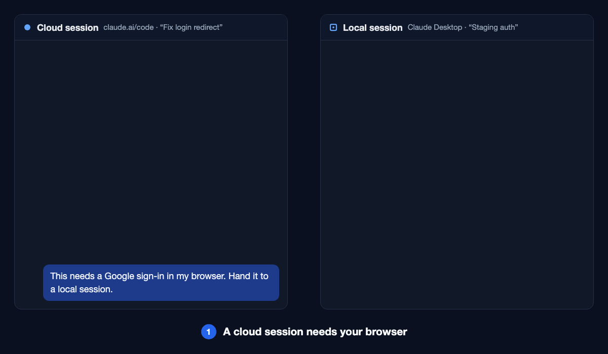

# Molt for Claude Code

**A Claude Code workflow kit that sheds its shell as best practices change.**

Molt bundles the skills I use to work with Claude Code, and it changes as the way I work changes.
Today it hands browser, sign-in and local-file steps from cloud sessions to your computer, runs
related tasks in parallel sessions, tracks them on a live plan board, and keeps long-running
orchestrators' memory in a private wiki.

*Formerly Cloud Local Bridge. Already installed it? See [Renamed from Cloud Local Bridge](#renamed-from-cloud-local-bridge).*

[Website](https://shijianxi.github.io/molt/) ·
[Install](#install) ·
[FAQ](#faq)



## What it does

- **Tasks that need your computer.** Browser use, OAuth sign-ins, local files, desktop apps and
  local MCP servers. The cloud session hands the step to your computer and gets the result back.
- **Picks the right local session.** It asks which open session should do the work, or starts a
  new one for you.
- **Replies find their way back.** No session ids to copy around.
- **Runs tasks in parallel.** One session per task, and you only talk to one.
- **Tracks big tasks on a live plan board.** See every task, its order and what blocks it.
- **Long-running orchestrators keep a private wiki.** One per domain, read only by that session,
  so you can `/compact` or `/clear` it and it picks up where it left off.

## Install

Add it once to your claude.ai account. Your cloud and local sessions both get it.

1. Open [Customize → Plugins](https://claude.ai/customize/plugins) on claude.ai or in Claude
   Desktop.
2. Find **Molt** under **Discover** and choose **Add**.
3. Start a new session.

Not in Discover yet, or want the newest version? Choose **Add → Add marketplace** instead and enter
`ShiJianXi/molt`.

<details>
<summary>Other ways to install</summary>

| Way | Works in cloud sessions? |
|---|---|
| `/plugin install molt --marketplace ShiJianXi/molt` in a local session | No, that computer only |
| Upload each folder in `skills/` under claude.ai → Customize → Skills | Yes |
| Copy the `skills/` folders into a repository's `.claude/skills/` | Only for that repository |
| `npx skills add ShiJianXi/molt` | No |

Pick one. Installing two ways loads everything twice.

</details>

## Use it

Just ask in a cloud session:

- "This needs my browser. Hand it to my computer."
- "Read the file in my Downloads folder."
- "Orchestrate these three tasks, one session each."
- "Plan this and track it on a board."
- "Own billing from now on and keep a wiki."

You need a local Claude session on the same account, connected to Remote Control. In Claude
Desktop, turn on **Connect new sessions to Remote Control**. In a terminal, run
`claude remote-control`.

### Let the cloud start local sessions for you

Run this in your project folder and leave it open:

```
claude remote-control --spawn worktree --chrome
```

The cloud session can then start a fresh local session whenever it needs one. Each gets its own
git worktree and can use your browser.

## Good to know

- Read the reply in the cloud session. Delivery back to the cloud isn't confirmed.
- Run parallel tasks from a cloud session in **auto** mode, or they stall waiting for approvals.
- Don't use bypass-permissions mode for the local session. It holds messages from the cloud, and
  Desktop drops them after 5 minutes.
- An orchestrator with a wiki writes to it only when a fact would otherwise be lost. Only that
  session reads it. After `/compact` or `/clear` it picks the wiki back up by itself; after a
  restart, say "resume my <domain> orchestrator".

## Renamed from Cloud Local Bridge

This plugin was called **Cloud Local Bridge** (`cloud-local-bridge`) until version 2.0.0. Claude
Code treats the new name as a different plugin, so an old install stops getting updates. Remove
**Cloud Local Bridge** under Customize → Plugins and add **Molt**. Old GitHub links redirect here.

## FAQ

**How do I let Claude Code on the web do something that needs my computer?**
Install this plugin and ask the cloud session to hand that step to your computer. A local Claude
session does it and sends the result back.

**Why does SendMessage say "No agent named 'session_…' is reachable"?**
Local sessions can't reach a cloud session by its id, only by its title. The plugin uses the title
for you.

**Can I clear or compact a long-running orchestrator?**
Yes, if it keeps a wiki. Ask it to own a domain and keep a wiki. It saves decisions and what's
running as they happen, so `/compact` and `/clear` lose nothing. Each wiki is private to the one
session that owns it.

**Does it collect any data?**
No. It has no servers and makes no network calls. See the [privacy policy](PRIVACY.md).

**Is it free?**
Yes. Free and open source.

## License

MIT
