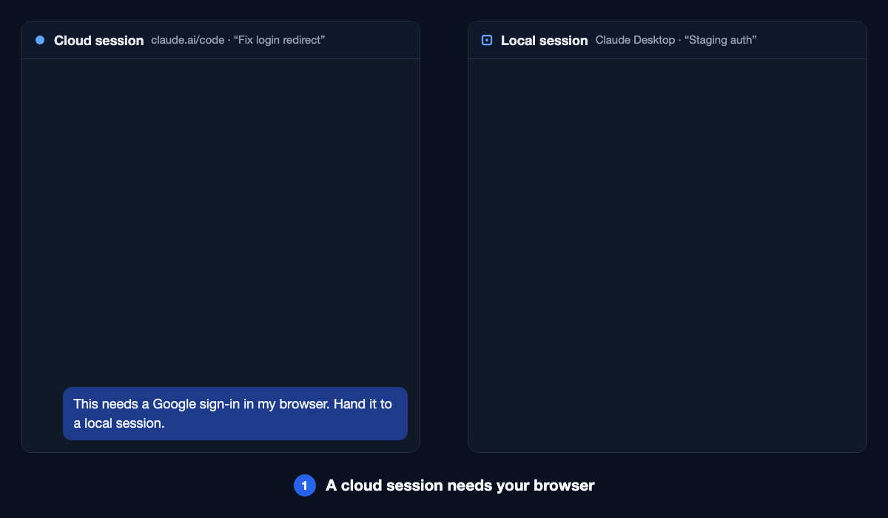

# cloud-local-bridge

A Claude Code plugin and skill for handing work from a cloud session (Claude Code on the web,
claude.ai/code) to a local session on your computer (Claude Desktop or `claude remote-control`) and
getting the result back, without you naming either session by hand. Use it when a cloud session
needs your browser, an OAuth sign-in, a desktop app, local files or a local MCP server. It can also
run several related tasks in parallel sessions from one orchestrator session.

## The problem it fixes

Cloud sessions can't use your browser, run OAuth sign-ins or reach local files, so you delegate
that part to a local session. Without help, two things go wrong:

- **The reply gets lost.** A message from a cloud session tells the local session to reply with
  "the send_message tool of the Claude Code Remote MCP server", using the cloud session's
  `session_…` id. Local sessions don't have that tool, and the id doesn't resolve: `SendMessage`
  fails with `No agent named 'session_…' is reachable.` and `mcp__ccd_session_mgmt__send_message`
  with `session session_… not found. (delivery: undelivered)`. Only `SendMessage` to the cloud
  session's **title**, as `ListAgents` prints it, gets through.
- **The local session isn't found.** It has to be open, unarchived and connected to Remote
  Control. Desktop sessions archive themselves when their PR closes, and terminal sessions only
  show up when started with `claude remote-control`.

The skill gives both sides a fixed procedure. The sender lists your local sessions and asks which
one gets the work, or helps you open a new one. It puts a short header on the brief with its own
title and the topic. The receiver uses that header to find the reply target, and asks you to pick
from a list only when that fails.

The plugin's second skill, `orchestrate`, is for several related tasks at once: one session acts
as the orchestrator and starts a session per task. See [Orchestrate several
sessions](#orchestrate-several-sessions).

## Install

Both sides need the plugin: the cloud session that hands work down and the local session that does
it. Add it once to your claude.ai account and it reaches both.

1. Open [Customize → Plugins](https://claude.ai/customize/plugins) on claude.ai or in the Claude
   desktop app.
2. Find **Cloud Local Bridge** under **Discover**, choose **Add**, and leave it turned on.
3. Start a new session. Plugins load when a session starts; in a local session that is already
   open, run `/reload-plugins`.

It then loads in your cloud sessions (claude.ai/code) and in local sessions signed in to the same
account.

The Discover listing can be a release behind this repository while Anthropic reviews an update. To
get the latest release, or if Discover doesn't show the plugin, choose **Add → Add marketplace** in
step 2 instead, enter `ShiJianXi/cloud-local-bridge`, and add **cloud-local-bridge** from the
plugin list. On Team and Enterprise plans, an Owner may have to allow adding marketplaces.

### Other ways to install

| Way | Reaches cloud sessions? |
|---|---|
| `/plugin install cloud-local-bridge --marketplace ShiJianXi/cloud-local-bridge` in a local Claude Code session | No, that machine only |
| Zip `skills/cloud-local-bridge` (and `skills/orchestrate`) and upload each under claude.ai → Customize → Skills | Yes |
| Commit `skills/cloud-local-bridge` (and `skills/orchestrate`) to a repository's `.claude/skills/` | Only for that repository |
| `npx skills add ShiJianXi/cloud-local-bridge`, or copy the folder into `~/.claude/skills/` | No |

Use one way per account. The claude.ai plugin plus a skill upload loads the skill twice.

### Optional: start local sessions from claude.ai

When the cloud session asks which local session to use, you can also have it open a new one. To
start that session from claude.ai/code or your phone instead of at your computer, set the computer
up once in either of these ways:

- **Claude Desktop:** in **Settings → Claude Code**, turn on **Use this computer from your phone
  and claude.ai** and add your project folders under it. It works while the app is open and the
  computer is awake. The docs describe this switch for Claude Projects, so it may not appear on
  every plan.
- **Terminal:** in the project folder, run
  `claude remote-control --spawn worktree --chrome` and leave it running. `--spawn worktree` gives
  each new session its own git worktree, and `--chrome` lets those sessions use your browser.

Then start a new session on claude.ai/code and pick your computer in its Remote Control menu.

While the terminal command is running, the cloud session can also start the local session by
itself: it offers **Start one on `<computer>:<folder>` for me** next to **I'll open one myself**,
and you pick one. The first time, Claude asks you to approve this on a trusted device. That
approval can't be undone: it limits that cloud session to your trusted devices. Each session it
starts gets its own git worktree under `.claude/worktrees/`. This avoids most "local session went
inactive" failures, because a fresh session can be started when it's needed.

Anyone signed in to your claude.ai account can start sessions in those folders, so keep the list
short.

## Examples

1. **Cloud session needs a browser sign-in.** In a cloud session, type: "This needs an OAuth
   sign-in in my browser, delegate it to a local session." The skill lists your open local sessions
   and asks which one to use. Other choices: starting a new one on your computer itself, when
   `claude remote-control --spawn worktree` is running there, or you opening one while it waits. It then sends the brief with a
   `HANDOFF` header that carries the cloud session's title and the topic.
2. **Local session sends the result back.** The local session gets a
   `<cross-session-message from-session="session_…">`, does the task, then finds the cloud session
   in `ListAgents` by the title in the header and replies with `SendMessage`, so you don't have to
   name it.
3. **The cloud session was renamed.** No `ListAgents` row matches the header's title any more. The
   local session falls back to the one cloud row whose title matches the header's topic. If none
   or several match, it asks you to pick from the cloud sessions it can see, and does not send to a
   guess.

## Orchestrate several sessions

When you have several related tasks, such as three that touch the same area, ask a session
to orchestrate them: "orchestrate these three tasks, one session each". That session then:

1. splits the work into one task per session, and points out tasks that edit the same files;
2. does the shared work once, such as updating task status or reading the code all the tasks
   touch, with your approval;
3. asks whether the sessions should run in the cloud or on your computer, and recommends one;
4. starts one session per task, each with its own branch and a brief that says what the others
   are doing;
5. passes on what each session reports, asks you the questions they can't answer, and sends your
   answers back;
6. asks you, as each session finishes its task, whether to archive that session or keep it
   (for example, to answer review comments on its PR).

You only talk to the orchestrator. The child sessions report to it and never ask you directly,
because nobody is watching them. If `send_later` is available, the orchestrator also checks on them on a schedule,
because a session that finishes cleanly doesn't report back on its own.

Start the orchestrator in a cloud session (claude.ai/code) in **auto** mode: cloud children are
started in auto mode, which they can't get if the orchestrator runs in a less permissive one, and in
default mode they stall on prompts nobody sees. Local
children each get their own git worktree. Don't archive the orchestrator until it has finished, or
the children's reports go nowhere.

## Limits

- Delivery from a local session to a cloud session is never confirmed. Read the reply in the cloud
  session's transcript.
- A local session in bypass-permissions mode holds messages from cloud sessions, and Desktop drops
  them after 5 minutes.
- The tools a cloud session uses to list local sessions aren't documented, so the skill tells it to
  search for them before deciding there is no local session.
- Anthropic's docs list plugins synced from claude.ai for Cowork and terminal sessions only. In
  October 2026 they also loaded in claude.ai/code cloud sessions, which is what the recommended
  install relies on.

## License

MIT
